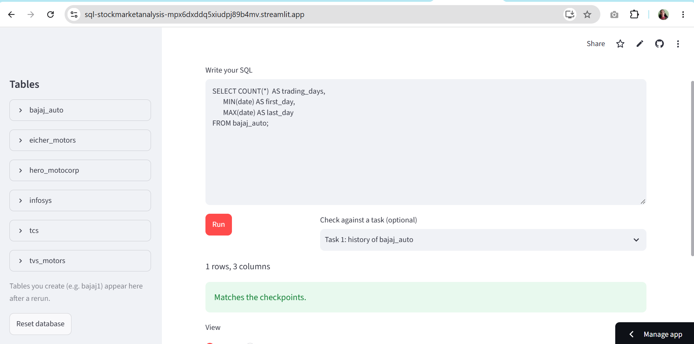

**Live demo:** https://sql-stockmarketanalysis-mpx6dxddq5xiudpj89b4mv.streamlit.app/
# SQL Stock Market Analysis

A Streamlit app for practising SQL on real stock market data. It loads daily price data for six NSE-listed stocks and lets you run SQL queries for 13 analysis tasks, from basic counts to moving averages and golden-cross Buy/Sell signals.

## Stocks covered

| Stock | Data file |
|---|---|
| Bajaj Auto | `data/Bajaj_Auto.csv` |
| Eicher Motors | `data/Eicher_Motors.csv` |
| Hero MotoCorp | `data/Hero_Motocorp.csv` |
| Infosys | `data/Infosys.csv` |
| TCS | `data/TCS.csv` |
| TVS Motors | `data/TVS_Motors.csv` |

Period: 1 Jan 2015 to 31 Jul 2018 (889 trading days per stock).

## What the app does

- Builds the database from the CSV files in the `data` folder when the app starts
- Lets you write and run SQL queries and see the results as tables
- Checks your results against expected values for each task

## Tasks

1. Trading days, first date and last date
2. Five highest closing prices
3. Average closing price per year
4. Find rows with missing deliverable quantity
5. 20-day and 50-day moving averages
6. Combine all six stocks into one master table
7. Golden-cross Buy / Sell / Hold signals
8. Count of each signal
9. Look up the signal for a given day (query and MySQL function)
10. Signals for all six stocks in one query
11. Which stocks went up over the period
12. Find the worst single-day move for each stock (data check)
13. Adjust TCS and Infosys prices for bonus issues

## Tech stack

Python, Pandas, Streamlit, SQL (MySQL 8 syntax with window functions)

## How to run

```bash
git clone https://github.com/dhamayanthidevik/Sql-StockMarketAnalysis.git
cd Sql-StockMarketAnalysis
pip install -r requirements.txt
streamlit run app.py
```

## Project structure

```
Sql-StockMarketAnalysis/
├── app.py            # Streamlit interface and task checks
├── DB.py             # Loads the CSV files into the database
├── data/             # Stock price CSV files
├── requirements.txt
└── README.md
```

## Key learnings

- Window functions (`LAG`, `ROW_NUMBER`, moving averages with `ROWS BETWEEN`)
- CTEs and joins across multiple tables
- Data cleaning: handling NULLs and fixing prices distorted by bonus issues

## Screenshot



## Author

Dhamayanthi Devi K
[GitHub](https://github.com/dhamayanthidevik) | [LinkedIn](https://www.linkedin.com/in/dhamayanthi-devi-kumaramangalam-b31a1324b/)